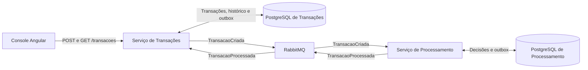

# CredPay

> Simulador de transações assíncronas com Java, Spring Boot, RabbitMQ e Angular.

O CredPay permite cadastrar uma transação fictícia em reais, acompanhar seu processamento e consultar o resultado por UUID. A aprovação segue um limite configurável por moeda. Os dados são fictícios e o fluxo é voltado a portfólio e aprendizado de engenharia de software.

**João Pedro Magalhães · Engenheiro de software no projeto CredPay**

Responsável pela direção do projeto, pelas decisões de arquitetura e escopo e pelos aceites locais. [Perfil no GitHub](https://github.com/Joaomagh)

## O que dá para demonstrar

- **Nova transação** — enviar um valor pelo console Angular, receber o estado `PENDENTE` e acompanhar o pedido pelo mesmo UUID.
- **Consulta** — ver o estado atualizado, inclusive `APROVADA` ou `REJEITADA`, e retomar a consulta com o identificador.
- **Reenvio seguro** — repetir o mesmo pedido com a mesma `Idempotency-Key` preserva a resposta original. Reutilizar a chave para outro pedido retorna conflito.
- **Contas de demonstração** — entrar e sair do console, criar e consultar somente as próprias transações e recuperar o recibo da própria conta. O perfil local inclui CSRF e limites por operação. [Guia do console](frontend/README.md#entrada-no-perfil-de-contas)
- **Recuperação** — com o processador indisponível, o pedido permanece pendente. Quando ele volta, o processamento pode concluir a transação original. O roteiro de diagnóstico também reproduz eventos sem rota e confirma a recuperação sem duplicar registros.

## Como funciona

O `POST /transacoes` responde `201 Created` depois de registrar a transação como pendente. O processador aplica a regra de limite em segundo plano e o resultado volta por evento. O `GET /transacoes/{id}` retorna o estado atual. Cada serviço grava seus dados e a intenção de publicar o evento no mesmo commit local, usando **Transactional Outbox**. Como o RabbitMQ pode reentregar mensagens, os consumidores preservam o resultado de uma execução equivalente.

| Camada | Implementação |
| --- | --- |
| Backend | Dois serviços com Java 21, Spring Boot 4 e Maven Wrapper |
| Autenticação da demo | Spring Security, sessão no servidor, CSRF e autorização por conta |
| Dados | PostgreSQL por serviço, migrations Flyway e valores monetários com `BigDecimal` |
| Mensageria | RabbitMQ, filas quorum, confirmações de publicação, retry limitado e DLQ |
| Frontend | Angular 22 com interface responsiva e criação/consulta pela API real |
| Entrega e diagnóstico | Docker Compose, Kubernetes com kind, GitHub Actions, Actuator e Micrometer |

## Executar localmente

1. **Backend.** Siga o [quickstart de Docker Compose](infra/compose/README.md) para construir as imagens, preparar a infraestrutura, ativar os consumidores e rodar a demo. No Windows, o roteiro usa JDK 21, PowerShell 7.3+ e Docker com engine Linux acessível.
2. **Interface.** Com o backend ativo, siga o [guia do Angular](frontend/README.md) para instalar as dependências pelo lockfile e iniciar o servidor local. A interface abre em [127.0.0.1:4200](http://127.0.0.1:4200).
3. **Teste a jornada.** Crie uma transação, acompanhe pelo UUID e consulte o resultado. O [roteiro de demonstração](docs/DEMO.md) inclui aprovação, rejeição, replay e pontos para explicar em entrevista.

Para verificar os módulos Java, execute `./mvnw.cmd --batch-mode --no-transfer-progress verify` no PowerShell, dentro de cada serviço. Em Linux ou macOS, use `./mvnw`. As suítes de integração precisam de Docker com engine Linux para iniciar PostgreSQL e RabbitMQ descartáveis.

## Qualidade e estado da v1

- **Testes.** Os cenários incluem concorrência, rollback, duplicatas, reentrega e fluxo com PostgreSQL e RabbitMQ reais. O CI de navegador executa seis casos no modo padrão e dois no modo de contas, em desktop e celular. [Validação da v1](docs/V1_VALIDATION.md) · [Jornadas com contas](https://github.com/Joaomagh/credpay/actions/runs/41907646479)
- **Operação local.** A execução assistida validou Compose, persistência e recuperação em Kubernetes, além do diagnóstico por métricas dos dois publicadores. Os aplicativos rodaram sem privilégios no recorte testado. [Kubernetes local](infra/k8s/LOCAL.md) · [Diagnóstico por métricas](infra/observability/README.md)
- **Segurança.** O inventário de 04/11 do candidato `51f8476` encontrou zero achados HIGH ou CRITICAL nos dois JARs e nas duas imagens. Achados MEDIUM e LOW seguem em triagem. [Validação do corte](docs/V1_VALIDATION.md#manutenção-das-imagens--0411) · [Triagem](infra/security/TRIAGE.md)
- **Fechamento.** O candidato operacional da v1 está registrado. A promoção aguarda o ensaio autônomo e a revisão final do corte. A demo pública está em planejamento. [Candidato da v1](docs/V1_CANDIDATE.md) · [Plano da demo pública](docs/PUBLIC_DEMO_PLAN.md)

## Documentação

| Leitura | Conteúdo |
| --- | --- |
| [Relatório do projeto e do backlog](docs/ENTENDA_O_CREDPAY.md) | Exemplo ponta a ponta, decisões de engenharia, entregas e pendências |
| [Backlog detalhado](docs/BACKLOG.md) | Histórias, critérios de aceite, dependências e histórico |
| [Especificação](spec.md) | Contratos, decisões técnicas, testes, evidências e limites |
| [Plano do projeto](CREDPAY_PLAN.md) | Objetivo, fases e critérios de fechamento |
| [Confirmação de falha](docs/CONFIRMACAO_FALHA.md) | Aplicação controlada de `FALHOU` e limites operacionais |

O repositório ainda não declara uma licença.
